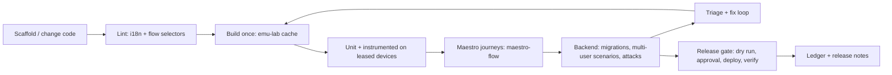

# android-kit: implementation plan

## Goal

One installable toolkit that an AI coding agent (via MCP) or a developer (via CLI and skills) can use to build, test, secure, localize and ship an Android app end to end. It combines five tools that are also distributed separately:

| Tool | Role in the kit |
|---|---|
| [`emu-lab`](https://github.com/fridaysundaymood/emu-lab) | Devices: leased emulators, isolated builds, deterministic app state, test runners, failure triage |
| [`maestro-flow`](https://github.com/fridaysundaymood/maestro-flow) | UI journeys: Maestro flows written from journeys and string resources, linted, iterated on devices |
| [`supa-multiuser-harness`](https://github.com/fridaysundaymood/supa-multiuser-harness) | Backend: verified local Supabase, multi-user fixtures, simulated phones, permission and race attack suite |
| [`indonesian-english-linter`](https://github.com/fridaysundaymood/indonesian-english-linter) | Localization: display-boundary checks for EN/ID (configurable locale pairs) |
| [`supa-release-gate-mcp`](https://github.com/fridaysundaymood/supa-release-gate-mcp) | Release: plan → dry run → approval → execute → verify → ledger for Supabase, Play, Cloudflare, GCP |

Separate repos first so each is useful and reviewable on its own; the kit is the composition, not a rewrite.

## End-to-end lifecycle the kit covers

## Design rules for composability (apply to every tool from day one)

These keep the separate repos combinable without rewrites. Each tool's plan should link here and follow them.

1. **Shared result schema.** Every tool returns the same envelope:
   `{ tool, operation, status: pass|fail|blocked|unsupported, classification?: app|test|environment|config, evidence[], artifacts[], started_at, duration_ms }`.
   Publish it as a versioned JSON Schema package `kit-schema` (first repo to need it creates it; others depend on it).
2. **One project config file.** `android-kit.yaml` at the app root, with a section per tool (`emuLab`, `maestroFlow`, `backend`, `i18n`, `releaseGate`). Tools ignore sections they do not own and never require another tool's section.
3. **Artifact layout.** `.android-kit/runs/<run-id>/<tool>/…` with an index file; paths in results are relative to the project root.
4. **MCP naming.** Tool names are prefixed by tool (`emu_lab_*`, `maestro_flow_*`, `backend_*`, `i18n_*`, `release_*`) so they can be mounted together in one server without collisions.
5. **Library-first.** Each tool is a library + thin CLI + thin MCP adapter. The kit's single MCP server imports the libraries; it does not shell out to the separate servers.
6. **No hidden coupling.** Cross-tool use goes through the public API (e.g. maestro-flow asks emu-lab for a lease via its library interface, falling back to a plain `adb` serial when emu-lab is absent).
7. **Safety defaults.** Production writes only through the release gate; device tools never touch devices they did not create or lease; backend tools refuse remote/linked projects.
8. **Synthetic fixtures only.** A shared sample app (`kit-fixture-app`: Kotlin/Compose, EN/ID, small Supabase schema with shared groups) is the golden target for every tool's tests and demos.

## Kit deliverables

- **`android-kit` MCP server**: mounts all tool libraries; adds orchestration tools:
  - `kit_status` (devices, backend, lint state, pending releases),
  - `kit_verify(scope)` (lint → build → instrumented → Maestro → backend scenarios → summary),
  - `kit_release_readiness` (runs verify, then prepares release-gate plans without executing).
- **Skill pack**: one `SKILL.md` per lifecycle stage (setup, test, triage, localize, secure, release) that tells an agent which tools to call in what order and how to read the shared result schema.
- **CLI**: `kit init` (writes `android-kit.yaml`, detects Gradle modules, string resources, Supabase folder), `kit verify`, `kit release plan`.
- **Docs site**: getting started on Windows/macOS/Linux, the lifecycle above, one walkthrough on `kit-fixture-app`.

## Milestones

1. **K0 (now, during tool M1s):** publish `kit-schema` and `android-kit.yaml` spec; every tool adopts them in its first milestone.
2. **K1:** `kit-fixture-app` repo with seeded defects for each tool (unlabeled control, stale selector, raw-id display, RLS hole, race, state-leak test).
3. **K2:** kit MCP server mounting emu-lab + maestro-flow; `kit_verify` for the device half.
4. **K3:** add backend harness and linter to `kit_verify`.
5. **K4:** release gate integration and `kit_release_readiness`; skill pack; docs site.
6. **K5:** community release: versioned packages, templates, example CI.

## Distribution

- Each tool: own repo, own releases, usable alone.
- Kit: depends on tool packages by version range; one install command; one MCP config entry.
- Versioning: tools follow semver; the kit pins compatible minors and runs the fixture app suite in CI on every bump.

## Risks

- Tools drift apart before the kit exists: mitigated by K0 (shared schema/config adopted in each tool's first milestone).
- Too much surface for agents: the kit exposes orchestration tools first and keeps per-tool tools available for advanced use.
- Platform differences (emulator acceleration, Docker for Supabase) on Windows/macOS/Linux: doctor command `kit doctor` reports missing prerequisites with fixes.
