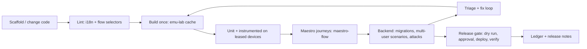

# android-kit: implementation plan

## Goal

One installable toolkit that any MCP client, agent, developer, or CI system can use to build, test, secure, localize and ship an Android app end to end. It combines five tools that are also distributed separately:

| Tool                                                                                         | Role in the kit                                                                                           |
| -------------------------------------------------------------------------------------------- | --------------------------------------------------------------------------------------------------------- |
| [`emu-lab`](https://github.com/fridaysundaymood/emu-lab)                                     | Devices: leased emulators, isolated builds, deterministic app state, test runners, failure triage         |
| [`maestro-flow`](https://github.com/fridaysundaymood/maestro-flow)                           | UI journeys: Maestro flows written from journeys and string resources, linted, iterated on devices        |
| [`supa-multiuser-harness`](https://github.com/fridaysundaymood/supa-multiuser-harness)       | Backend: verified local Supabase, multi-user fixtures, simulated phones, permission and race attack suite |
| [`indonesian-english-linter`](https://github.com/fridaysundaymood/indonesian-english-linter) | Localization: display-boundary checks for EN/ID (configurable locale pairs)                               |
| [`supa-release-gate-mcp`](https://github.com/fridaysundaymood/supa-release-gate-mcp)         | Release: plan → dry run → approval → execute → verify → ledger for Supabase, Play, Cloudflare, GCP        |

Separate repos first so each is useful and reviewable on its own; the kit is the composition, not a rewrite.

## End-to-end lifecycle the kit covers

## Design rules for composability (apply to every tool from day one)

These rules are the shared contract for the kit and each separately distributed tool.

1. **MCP names.** Prefix every tool as follows, including orchestration:

   | Component                 | Prefix           |
   | ------------------------- | ---------------- |
   | emu-lab                   | `emu_lab_*`      |
   | maestro-flow              | `maestro_flow_*` |
   | supa-multiuser-harness    | `backend_*`      |
   | supa-release-gate-mcp     | `release_*`      |
   | indonesian-english-linter | `i18n_*`         |
   | kit orchestration         | `kit_*`          |

2. **Result envelope.** Publish the v1 JSON Schema as the semver-versioned `kit-schema` package. Every tool returns `{ schema_version: "1", tool, operation, run_id, status: pass|fail|flaky|blocked|unsupported|error, classification?: app|test|environment|config, summary, evidence[], artifacts[], started_at, duration_ms }`. `fail` means the thing under test failed; `error` means the tool itself failed; `blocked` means a precondition or policy refused the operation; `unsupported` means the capability is unavailable and is never silently skipped. Tools declare their supported `kit-schema` major; the kit refuses incompatible majors with a clear error.
3. **Layers and access.** Every tool has a core library, a CLI, and a thin tools-only MCP adapter using stdio. Every CLI command supports `--json` and emits the envelope; documented exit codes are 0 for pass, 1 for fail or flaky, and 2 for error, blocked, or unsupported. Everything available through MCP is also available through CLI. No adapter depends on client-specific features; optional MCP features such as progress or elicitation degrade gracefully.
4. **Runtime and composition.** emu-lab, the maestro-flow helper CLI, supa-multiuser-harness, supa-release-gate-mcp, and the kit use TypeScript on Node.js LTS; Bun is optional. The harness Android `harness-client` test library is Kotlin. indonesian-english-linter uses Kotlin/JVM. The kit composes TypeScript tools in-process through public libraries and invokes JVM tools as CLI subprocesses using `--json`. Distribute TypeScript tools as npm packages and the linter as a Maven/Gradle plugin and standalone CLI jar.
5. **Agent guidance.** Ship plain Markdown skill files in `SKILL.md` frontmatter format, readable by any agent, plus an `AGENTS.md` snippet. Each skill step names both the CLI command and its MCP tool equivalent; no instruction assumes a particular agent product.
6. **Configuration and artifacts.** Validate `android-kit.yaml` with a published JSON Schema; unknown keys are errors. Each tool owns its section (`emuLab`, `maestroFlow`, `backend`, `i18n`, or `releaseGate`) and never requires another tool's section. Write artifacts under `.android-kit/runs/<run-id>/<tool>/` with an index; result paths are relative to the project root.
7. **Production baseline.** Each tool plan has a "Production readiness" section covering Windows, macOS, and Linux support and per-OS caveats; pinned or declared external-tool versions and a `doctor` command reporting missing or incompatible prerequisites and fixes; semver and a CHANGELOG; CI unit tests on all three OSes and integration tests where feasible; structured logs; crash/interrupt recovery and idempotent re-runs; SECURITY.md and CONTRIBUTING.md planned for M1; and no telemetry.

Cross-tool use goes through public APIs; for example, maestro-flow can request an emu-lab lease or use a plain `adb` serial when emu-lab is absent. Production writes go through the release gate; device tools do not touch devices they did not create or lease; backend tools refuse remote or linked projects.

## Kit deliverables

- **`android-kit` MCP server**: exposes TypeScript libraries and the JVM CLI through the shared adapter; adds orchestration tools:
  - `kit_status` (devices, backend, lint state, pending releases),
  - `kit_verify(scope)` (lint → build → instrumented → Maestro → backend scenarios → summary),
  - `kit_release_readiness` (runs verify, then prepares release-gate plans without executing).
- **Skill pack**: one `SKILL.md` per lifecycle stage (setup, test, triage, localize, secure, release), with CLI and MCP equivalents for every step, plus an `AGENTS.md` snippet.
- **CLI**: `kit init` (writes `android-kit.yaml`, detects Gradle modules, string resources, Supabase folder), `kit status`, `kit verify`, `kit release plan`, `kit doctor`; each orchestration tool has a CLI equivalent.
- **Docs site**: getting started on Windows/macOS/Linux, the lifecycle above, one walkthrough on `kit-fixture-app`.

## Harness compatibility

The stdio MCP server works with any MCP client; the CLI works with any agent or CI without MCP. Skills are plain Markdown with frontmatter and an `AGENTS.md` snippet, with CLI and MCP equivalents for every step. Test against at least two different MCP clients and a CLI-only CI run.

## Milestones

1. **K0 (done):** `kit-schema` and `android-kit.yaml` spec implemented; every tool adopts them in its first milestone.
2. **K1:** `kit-fixture-app` repo with seeded defects for each tool (unlabeled control, stale selector, raw-id display, RLS hole, race, state-leak test).
3. **K2:** kit MCP server mounting emu-lab + maestro-flow; `kit_verify` for the device half.
4. **K3:** add backend harness and linter to `kit_verify`.
5. **K4:** release gate integration and `kit_release_readiness`; skill pack; docs site.
6. **K5:** community release: versioned packages, templates, example CI.

## Distribution

- Each tool: own repo, own releases, usable alone.
- Kit: npm package with versioned TypeScript dependencies and the standalone linter CLI jar; one MCP config entry is optional.
- Versioning: tools and `kit-schema` follow semver. Tools declare supported schema majors; the kit rejects incompatible majors with a clear error, pins compatible minors, and runs the fixture app suite in CI on every bump.

## Production readiness

- Support Windows, macOS, and Linux; document emulator acceleration, Android SDK paths, and Docker/Supabase setup caveats per OS. Declare supported Node.js LTS, Java, adb, emulator, Gradle, Maestro, Supabase CLI, and Docker versions; `kit doctor` reports missing or incompatible prerequisites and fixes.
- Use semver and a CHANGELOG. Run unit tests on all three OSes and integration tests where feasible, including the harness compatibility checks above.
- Emit structured logs, recover from crashes and interrupts, and make re-runs idempotent. Plan SECURITY.md and CONTRIBUTING.md for M1. Do not collect telemetry.

## Risks

- Tools drift apart before the kit exists: mitigated by K0 (shared schema/config adopted in each tool's first milestone).
- Too much surface for agents: the kit exposes orchestration tools first and keeps per-tool tools available for advanced use.
- Platform differences (emulator acceleration, Docker for Supabase) on Windows/macOS/Linux: doctor command `kit doctor` reports missing prerequisites with fixes.
