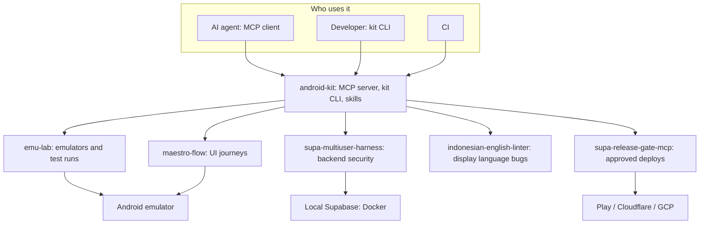
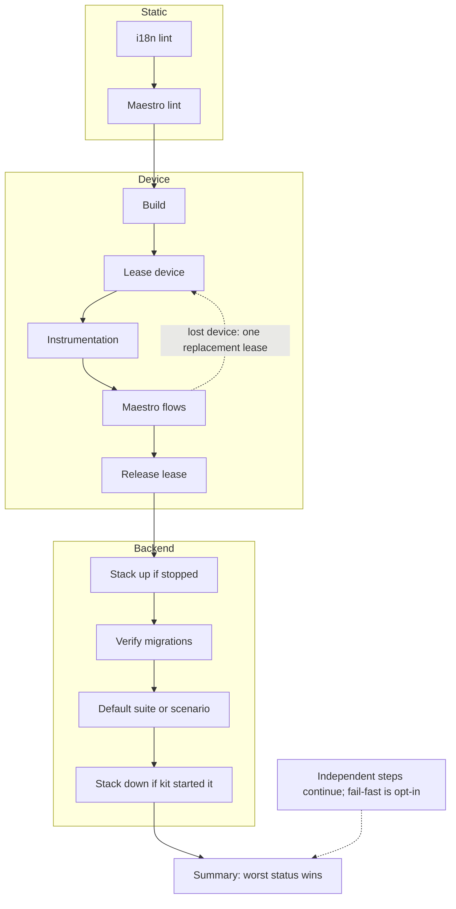

# android-kit

Shared Android development tools for CLI and MCP clients.

## Status

The repository contains the shared [result schema](docs/kit-schema.md), [configuration contract](docs/android-kit-yaml.md), kit CLI and MCP orchestration, lifecycle [skills](skills/), and a VitePress documentation site. The kit composes the sibling packages through their public tool definitions and configuration schemas; the i18n MCP package wraps its JVM CLI. External prerequisites remain separate; an unavailable or blocked capability is not a passing check. See [IMPLEMENTATION_PLAN.md](IMPLEMENTATION_PLAN.md) for milestones and remaining release work.

## The tools

Each one is useful on its own:

| Tool                                                                                       | Does                                                                                                  |
| ------------------------------------------------------------------------------------------ | ----------------------------------------------------------------------------------------------------- |
| [emu-lab](https://github.com/fridaysundaymood/emu-lab)                                     | Isolated emulators, cached builds, clean app state, test runners, failure triage                      |
| [maestro-flow](https://github.com/fridaysundaymood/maestro-flow)                           | Maestro UI flows written from user journeys and your string resources, linted and iterated on devices |
| [supa-multiuser-harness](https://github.com/fridaysundaymood/supa-multiuser-harness)       | Local Supabase with verified migrations, fake users, simulated phones, permission and race attacks    |
| [indonesian-english-linter](https://github.com/fridaysundaymood/indonesian-english-linter) | Localization linter for display/data boundaries (EN/ID first, any locale pair)                        |
| [supa-release-gate-mcp](https://github.com/fridaysundaymood/supa-release-gate-mcp)         | Plan, dry run, approve, deploy, verify, and record production changes                                 |

The kit brings five tools to agents, developers and CI, each operating on its own targets:


The release gate also supports Supabase releases; release planning alone does not deploy.

## Who it's for

Android developers (Kotlin/Compose, optionally Supabase) who use AI coding agents and want them to test and ship safely, not just write code.

## Installation

Install Node.js 24 or newer, then install the CLI from npm:

```sh
npm install -g @budaknyenyel/kit-cli
```

For development from source, clone `android-kit`, `emu-lab`, `maestro-flow`, `supa-multiuser-harness`, `supa-release-gate-mcp`, and `indonesian-english-linter` into the same parent directory. The kit uses local `file:` dependencies to those sibling checkouts. Run `npm ci` and `npm run build --workspace=@budaknyenyel/kit-schema` in `android-kit`, then run `npm ci` and `npm run build` in each sibling (the linter package is in its `mcp` directory). Finally run `npm run build` and `npm link --workspace=@budaknyenyel/kit-cli` in `android-kit`.

In an Android project:

```sh
kit init --json
kit doctor --json
kit status --json
kit verify --scope all --json
kit release plan --plan '<JSON object>' --json
```

Use `--root PATH` to select another project. `kit mcp` starts the stdio server. Direct MCP tools are also callable with `kit tool <MCP_TOOL_NAME> --args '<JSON object>' --json`. Status includes the backend and release gate's pending plans. A release plan must be supplied; planning does not approve or execute it.

For release tools, set the project and release-gate configuration when launching `kit mcp` or `kit tool` with `--root PATH` and `--config PATH`, or with `ANDROID_KIT_PROJECT_ROOT` and `ANDROID_KIT_RELEASE_CONFIG`. Flags take precedence over environment variables. Release tool arguments cannot change the project root or configuration.

`kit init` creates editable defaults for detected Android modules, localized resources, Maestro flows and Supabase projects. Verification builds and leases a device, runs instrumentation and discovered flows, then releases the lease; it reports unavailable prerequisites and capabilities explicitly.

For the full scope, verification runs these stages when their prerequisites are available:



Read the [getting-started guide](docs/getting-started.md) for platform prerequisites and the [fixture walkthrough](docs/fixture.md) for a synthetic example. Run `npm run docs:dev` to browse the site locally or `npm run docs:build` to build it. Templates for configuration and CI live in [templates](templates/); configure the external tools required by the chosen scope before using them.

## Contributing

The design is open for feedback. Open an issue to question scope, suggest a feature, or discuss an approach before sending a pull request. Use synthetic examples only: no private app code, production data, or credentials.

## License

[MIT](LICENSE)
