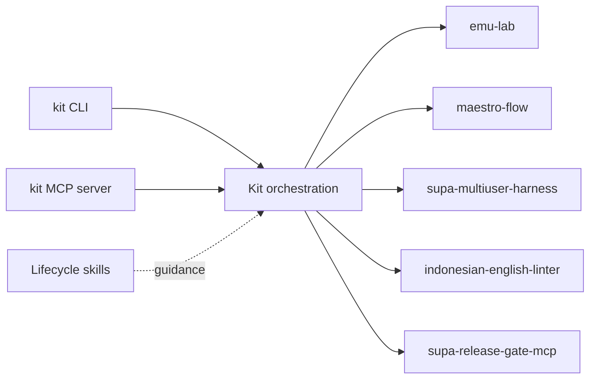

# Getting started

The kit composes separately distributed tools through their public APIs. Install Node.js 24 or newer and npm, then install the Android SDK command-line tools and a JDK compatible with your Android project. Device tests also need `adb`, an emulator and an appropriate system image; UI journeys need Maestro. Local backend scenarios need Docker and the Supabase CLI. The i18n MCP package invokes the JVM localization CLI. Release planning requires the relevant release-gate configuration; it does not authorize deployment.

The CLI and MCP server compose the five tools, with skills providing lifecycle guidance:



- **Windows:** enable a supported hypervisor for emulator acceleration, install the SDK in a writable path, and put Android platform-tools on `PATH`. Use PowerShell or a shell that can run your Gradle wrapper. Docker Desktop must be running before local Supabase operations.
- **macOS:** install Android SDK platform-tools and an emulator image matching the host architecture. Enable the Docker runtime before local Supabase operations.
- **Linux:** install Android SDK platform-tools and configure KVM access for accelerated emulation. Ensure your user can access the Docker daemon before local Supabase operations.

Install the CLI with `npm install -g @budaknyenyel/kit-cli`. For source development, see the [sibling checkout and build instructions](https://github.com/fridaysundaymood/android-kit#installation).

In the target project's root, run the installed `kit` executable:

```sh
kit init --json
kit doctor --json
kit status --json
kit verify --json
kit release plan --plan '<JSON object>' --json
```

Use `--root PATH` when operating on a different project. Review the detected settings in `android-kit.yaml` after `kit init`; an existing config is not overwritten unless you pass `--force`. `kit verify --scope SCOPE --json` selects a verification scope. `kit mcp` starts the stdio MCP server; configure an MCP client to launch it as a command, without mixing diagnostic output into its protocol stream. Installation alone does not install SDKs or start devices or a backend. Read `doctor` output for missing prerequisites before starting a requested operation.

For the full scope, verification runs these stages when their prerequisites are available:

```mermaid
flowchart LR
  Lint["i18n and Maestro lint"] --> Build["Build"]
  Build --> Lease["Lease device"]
  Lease --> Tests["Instrumentation"]
  Tests --> Flows["Maestro flows"]
  Flows --> Release["Release lease"]
  Release --> Backend["Backend verify and suite"]
  Backend --> Down["Stop stack if started by kit"]
  Down --> Summary["Result summary"]
```



The MCP Inspector CLI has been used against `kit mcp` to list the tools and call `kit_status`. The automated compatibility test also starts the built CLI over stdio with the official MCP SDK client, lists its tools, and calls `kit_doctor`. Run `npm run build` before `npm test` so that the test exercises the built entry point.

Each command's JSON result uses the [result envelope](./kit-schema.md). Treat `blocked` and `unsupported` as incomplete, not as passing checks. Artifacts belong beneath `.android-kit/runs/`; never place credentials or real user data in examples or fixtures.
